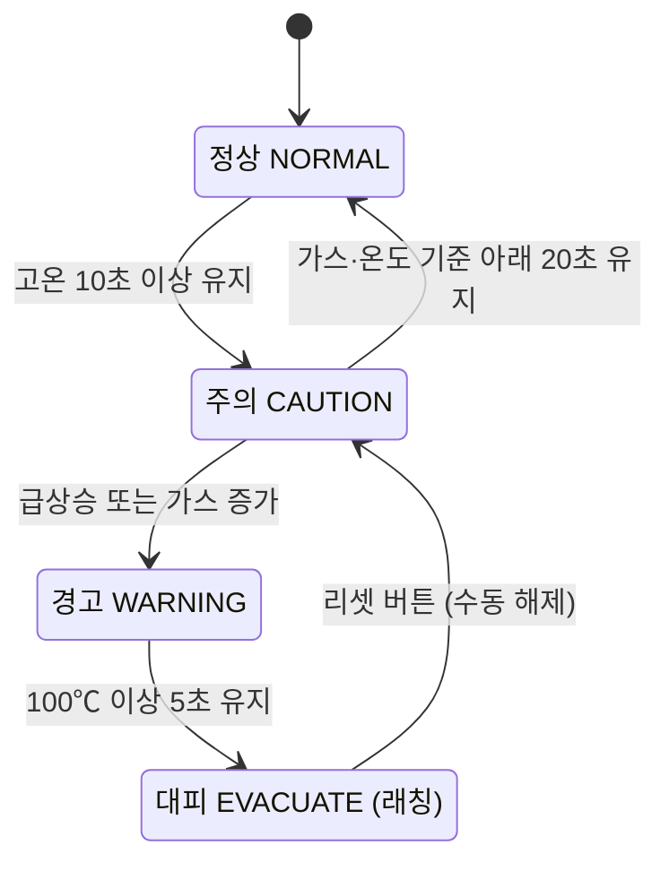

# 02. 경보 상태·전환 규칙 (상태 머신)

> **이 문서의 역할**
> 시스템이 어떤 경보 단계에 있을 수 있는지, 언제 다른 단계로 넘어가는지, 단계마다 무엇을 출력하는지 정합니다.
> `src/decision/`의 상태 머신 코드는 이 문서를 그대로 따릅니다.
>
> - 문서 버전: v0.2
> - 담당: 팀장 + 통합·문서
> - 근거: 2026-11-24 팀 회의 그림, [ADR-0001](ADR/0001-대피경보는-온도100도-이상.md) (대피는 100℃ 이상)
> - 관련 문서: [01-requirements](01-requirements.md) · [03-interface](03-interface.md) (`SystemState.level`, `reasons`) · 기준값은 [`config/thresholds.csv`](../config/thresholds.csv)

---

## 1. 상태 그림

## 2. 단계별 진입·해제 조건

| 단계 | 들어가는 조건 | 나가는 조건 | 관련 REQ |
|---|---|---|---|
| NORMAL 정상 | 시작 상태 | 고온(`T_HOT` 이상)이 `HOLD_SEC`(10초) 이상 유지 → 주의 | REQ-001 |
| CAUTION 주의 | 정상에서 고온 10초 유지, 또는 대피에서 리셋 | 급상승(`RATE_HOT`) 또는 가스 증가(`GAS_RATIO`) → 경고 / 가스·온도가 기준 아래로 `RELEASE_HOLD_SEC`(20초) 유지 → 정상 | REQ-002, 004, 013 |
| WARNING 경고 | 주의에서 급상승 또는 가스 증가 | `T_EXTREME`(100℃) 이상이 `EXTREME_HOLD_SEC`(5초) 유지 → 대피 | REQ-003 |
| EVACUATE 대피 | 100℃ 이상 5초 유지 | **리셋 버튼을 눌렀을 때만** → 주의 | REQ-003, 008 |

기준값의 실제 숫자는 [`config/thresholds.csv`](../config/thresholds.csv) 한 곳에서만 관리합니다.

## 3. 전환 규칙

1. **대피 조건은 "100℃ 이상 5초 유지" 하나뿐입니다** ([ADR-0001](ADR/0001-대피경보는-온도100도-이상.md)). 가스·급상승은 경고까지만 올립니다. 오경보를 줄이는 대신, 낮은 온도로 오래 지속되는 위험은 대피가 늦어질 수 있다는 한계를 팀이 알고 정한 결정입니다.
2. **5초 유지 조건은 노이즈 방지용입니다.** 열화상 값이 한 프레임 튀어서 100℃가 찍혀도 바로 대피하지 않습니다.
3. **대피는 저절로 꺼지지 않습니다 (래칭).** 원인이 사라져도 리셋 버튼을 눌러야 하고, 리셋 후에는 정상이 아니라 **주의**로 돌아가 다시 지켜봅니다.
4. **정상 복귀는 천천히.** 주의에서 정상으로는 가스·온도가 기준 아래로 20초 유지돼야 돌아갑니다. 기준값 근처에서 단계가 깜빡이는 것을 막습니다 (REQ-013).
5. **여러 조건이 겹치면** 이유를 모두 `reasons`에 기록합니다.

## 4. 단계별 출력

부저 주기는 위급할수록 빨라집니다. 아래 숫자는 **예시 값**이며, 실제 부저로 들어 보고 팀에서 정합니다.

| 단계 | LED | 부저 (켜짐 / 꺼짐) | 대피로 LED |
|---|---|---|---|
| NORMAL | 초록 상시 | 꺼짐 | 꺼짐 |
| CAUTION | 노랑 | 0.2초 / 1.8초 (느리게) | 꺼짐 |
| WARNING | 주황 | 0.2초 / 0.6초 (중간) | 꺼짐 |
| EVACUATE | 빨강 | 0.1초 / 0.1초 (빠르게) | **안전한 출구까지 초록 화살표**, 막힌 통로 빨강 |

## 5. 팀 확인이 필요한 것

그림에 아직 없는 경우들입니다. 정해지면 그림과 [01-requirements](01-requirements.md)를 같이 고칩니다.

- [ ] **정상에서 바로 100℃가 되면?** ADR-0001은 "어떠한 상황도 대피"라고 했는데, 그림은 경고를 거쳐야만 대피로 갑니다. 정상·주의에서도 바로 대피로 갈지 정해 주세요.
- [ ] **정상에서 가스가 늘면?** 지금 그림은 주의 단계에서만 가스를 봅니다.
- [ ] **경고 → 주의로 내려오는 길:** 급상승·가스가 사라지면 경고에서 내려오는지, 리셋이 필요한지
- [ ] **위험 구역 안 사람(REQ-005):** 단계를 올릴지, 같은 단계에서 경보 패턴만 바꿀지
- [ ] **센서 고장(REQ-010):** 고장 표시를 별도 상태로 둘지, 다른 단계 위에 덧붙일지
- [ ] **쓰러짐(REQ-006):** 어느 단계와 연결할지

## 6. 변경 이력

| 날짜 (KST) | 버전 | 바뀐 내용 | 작성 |
|---|---|---|---|
| 2026-11-24 | v0.1 | 팀 회의 그림 작성 (정상·주의·경고·대피) | 팀 |
| 2026-11-24 | v0.2 | 팀 그림을 기준으로 정리: 대피 조건 100℃ 5초(ADR-0001), 리셋 시 주의 복귀, 20초 해제, 단계별 출력표, 확인 필요 항목 추가 | 통합·문서 |
