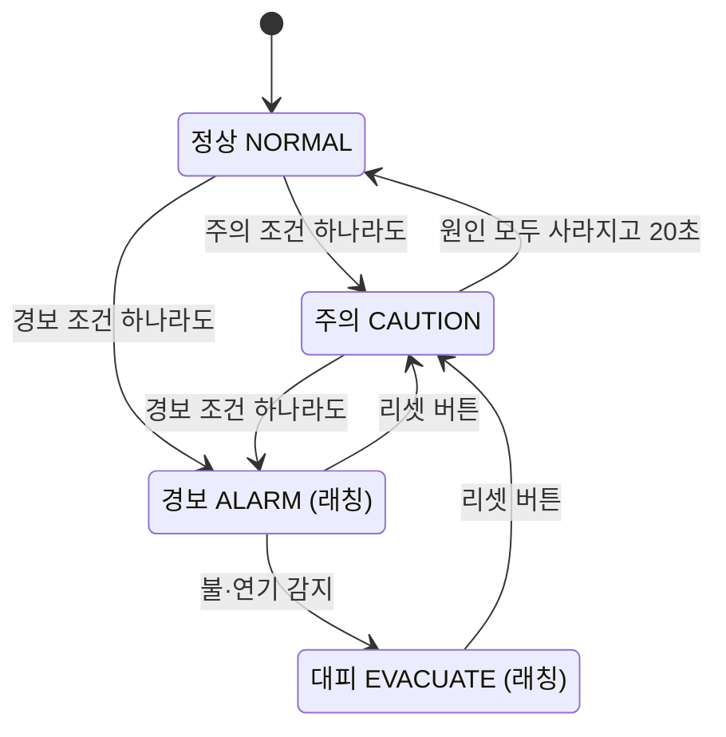

# 02. 경보 상태·전환 규칙 (상태 머신)

> **이 문서의 역할**
> 시스템이 어떤 경보 단계에 있을 수 있는지, 언제 다른 단계로 넘어가는지, 단계마다 무엇을 출력하는지 정합니다.
> `decision/`(판단 규칙·단계 판단)과 `core/controller.py`(래칭·리셋), `actuators/notifier.py`(출력)는 이 문서를 그대로 따릅니다.
>
> - 문서 버전: v0.5
> - 담당: 팀장 + 통합·문서
> - 근거: 2026-11-25 최종 기획안, [ADR-0002](ADR/0002-경보-3단계와-판단-기준.md)(주의·경보 조건), [ADR-0004](ADR/0004-대피-단계-추가.md)(대피 단계)
> - 관련 문서: [01-requirements](01-requirements.md) · [03-interface](03-interface.md) (`AlertLevel`, `Reason`, `Event`) · 설정값은 [`config.yaml`](../config.yaml)

---

## 1. 상태 그림

## 2. 단계별 진입 조건

### 주의 CAUTION — 하나라도 해당하면

| 사유 코드 | 조건 | 기준값 | 관련 REQ |
|---|---|---|---|
| `HOT_SUSTAINED` | 셀 온도 60℃ 이상이 5초 이상 지속 | `T_CAUTION`, `CAUTION_HOLD_SEC` | REQ-001 |
| `HOT_RISING` | 5초 안에 30℃ 이상 상승 (실측 후 확정) | `RISE_DELTA`, `RISE_WINDOW_SEC` | REQ-002 |
| `GAS_DETECTED` | 가스 센서 값이 깨끗한 공기 기준의 1.5배 이상 (실측 후 확정) | `GAS_CAUTION_RATIO` | REQ-004 |

### 경보 ALARM — 하나라도 해당하면

| 사유 코드 | 조건 | 기준값 | 관련 REQ |
|---|---|---|---|
| `HOT_EXTREME` | 셀 온도 100℃ 이상이 10초 이상 유지 | `T_ALARM`, `ALARM_HOLD_SEC` | REQ-003 |
| `HOT_CRITICAL` | 셀 온도 130℃ 이상 (즉시) | `T_CRITICAL` | REQ-022 |
| `GAS_DANGER` | 가스 센서 값이 깨끗한 공기 기준의 2배 이상 (실측 후 확정) | `GAS_ALARM_RATIO` | REQ-023 |
| `CAUTION_PROLONGED` | 주의 원인 중 하나가 1분 이상 지속 | `CAUTION_PROLONGED_SEC` | REQ-024 |

### 대피 EVACUATE — 경보 단계에서

| 사유 코드 | 조건 | 기준값 | 관련 REQ |
|---|---|---|---|
| `FIRE_SMOKE` | 경보 단계에서 일반 카메라로 불이나 연기를 감지 | `yolo.fire_min_conf` | REQ-026 |

온도 기준은 **실제 배터리 셀 기준**이며, 시연은 히터 안전 범위 안에서 축소 재현합니다. 시연용 값으로 바꿀 때는 같은 키의 숫자만 바꾸고 [08-progress-log](08-progress-log.md)에 이유를 남깁니다.

## 3. 전환 규칙

1. **위로는 바로, 아래로는 천천히.** 조건이 생기면 정상에서도 곧바로 경보까지 올라갈 수 있습니다(예: 130℃, 가스 2배). **대피는 경보를 거쳐서만** 들어갑니다. 내려올 때는 아래 3·4번 규칙을 따릅니다.
2. **유지 시간은 노이즈 방지용입니다.** 열화상 값이 한 프레임 튀어서 100℃가 찍혀도 10초가 지나야 경보가 됩니다. 단, 130℃는 이미 분리막이 녹을 수 있는 온도라 기다리지 않습니다.
3. **경보·대피는 저절로 꺼지지 않습니다 (래칭).** 원인이 사라져도 리셋 버튼을 눌러야 하고, 리셋 후에는 정상이 아니라 **주의**로 돌아가 다시 지켜봅니다. 리셋 순간에도 조건이 남아 있으면 바로 다시 그 단계가 됩니다 (REQ-008).
4. **주의는 원인이 모두 사라진 뒤 20초가 지나야 정상으로 돌아갑니다.** 20초 안에 원인이 다시 생기면 정상으로 내려가지 않습니다. 기준값 근처에서 단계가 깜빡이는 것을 막습니다 (REQ-013).
5. **여러 조건이 겹치면** 사유를 모두 `reasons`에 기록합니다.
6. **가스 센서 예열 전 값은 판단에 쓰지 않습니다** (REQ-017).
7. **센서 고장은 단계가 아닙니다** ([ADR-0005](ADR/0005-고장은-예외-처리와-관제-로그.md)). 데이터가 안 오면 예외 처리로 그 값만 빼고(`None`) 나머지로 판단을 계속하며, 관제 센터에 고장 로그를 보냅니다. 현장 LED·부저는 바뀌지 않고, 단계도 낮추지 않습니다 (REQ-010).

## 4. 단계별 출력

| 단계 | 상태 LED | 부저 | 스피커 | 출구 LED | 관제 센터 로그 (REQ-027) |
|---|---|---|---|---|---|
| NORMAL | 초록 상시 | 꺼짐 | — | 꺼짐 | 정상으로 돌아왔을 때 한 번 |
| CAUTION | 노랑 | 경보보다 **느린 주기**의 단속음 | 1.2배 범위 진입 시 안내 방송 (REQ-005) | 꺼짐 | 주의 + 사유 + 당시 데이터 |
| ALARM | 빨강 **빠르게 깜빡임** | **빠르고 급박한** 단속음 | 1.5배 범위 진입 시 안내 방송 (REQ-005) | 안전한 출구 "이쪽으로", 막힌 출구 "막힘" (REQ-009) | 경보 + 사유 + 당시 데이터 |
| EVACUATE | 빨강 **빠르게 깜빡임** | **빠르고 급박한** 단속음 | **대피 안내 방송** (REQ-025) | 경보와 같음 (REQ-009) | 대피 + 사유 + 당시 데이터 |
| (고장 — 단계 아님) | 변화 없음 | 변화 없음 | — | 변화 없음 | 고장 로그 / 복구 로그 |

**작업자 접근 안내 (REQ-005)** — 단계를 바꾸지 않고 스피커로만 알립니다.

| 단계 | 비교 범위 | 겹치면 |
|---|---|---|
| 주의 | 위험 구역을 **1.2배**로 넓힌 범위 | 안내 방송 |
| 경보 | 위험 구역을 **1.5배**로 넓힌 범위 | 안내 방송 (더 급한 문구) |
| 대피 | — | 전체 대피 안내 방송이 나가므로 따로 하지 않음 (7번 확인) |

같은 안내는 `person_warning.cooldown_sec`마다 한 번만 반복합니다. 계속 울리면 대피 안내 방송이 묻히기 때문입니다.

**출구 안내 (REQ-009, 018)**
- 출구 A·B 영역은 `config.yaml`에 일반 카메라 좌표로 정합니다 (03 2번).
- 경보·대피 단계에서, 위험 구역을 1.5배로 넓힌 범위가 출구 영역과 겹치면 그 출구는 "막힘"입니다.
- 둘 다 열려 있으면 위험 구역에서 더 먼 출구를 안내합니다. 둘 다 막히면 "대피로 없음" 패턴(두 출구 모두 막힘 표시 + 방송 문구)입니다.
- 한 번 정한 출구는 다른 출구가 더 낫다는 상태가 일정 시간 유지될 때만 바꿉니다 (REQ-018).

## 5. 부저 주기 (예시)

`config.yaml`의 `notifier.buzzer_period`(초, `null` = 끔)로 정합니다. 아래 숫자는 **예시 값**이며, 실제 부저로 들어 보고 팀에서 정합니다.

| 단계 | 주기 (예시) |
|---|---|
| NORMAL | `null` (끔) |
| CAUTION | 1.0초 |
| ALARM | 0.2초 |
| EVACUATE | 0.2초 (기획안상 경보와 같음 — 7번 확인) |

## 6. 기준값과 `config.yaml` 키 (제안)

지금 `config.yaml`은 단계 이름(`L1_HIGH` 등)과 값이 예시 상태입니다. 코드를 이 문서에 맞출 때 아래 키로 정리하는 것을 제안합니다 (03 8번 '코드 반영 필요 목록'). **실제 숫자는 `config.yaml` 한 곳에서만 관리**하고, 이 표는 그 요약입니다.

| 기호 | 뜻 | 값 | 제안 키 |
|---|---|---|---|
| `T_CAUTION` | 주의 온도 | 60℃ | `thermal.caution_temp` |
| `CAUTION_HOLD_SEC` | 주의 온도 지속 시간 | 5초 | `thermal.caution_hold_sec` |
| `RISE_DELTA` / `RISE_WINDOW_SEC` | 급상승 기준 | 30℃ / 5초 (실측 후) | `thermal.rise_delta`, `thermal.rise_window_sec` |
| `T_ALARM` | 경보 온도 | 100℃ | `thermal.alarm_temp` |
| `ALARM_HOLD_SEC` | 경보 온도 유지 시간 | 10초 | `thermal.alarm_hold_sec` |
| `T_CRITICAL` | 초고온 즉시 경보 | 130℃ | `thermal.critical_temp` |
| `ROI_RELEASE_SEC` | 위험 구역 해제 유지 시간 | (결정 필요, 지금 예시 5초) | `thermal.release_hold_sec` |
| `GAS_CAUTION_RATIO` | 가스 주의 배수 | 1.5배 (실측 후) | `gas.caution_ratio` |
| `GAS_ALARM_RATIO` | 가스 경보 배수 | 2배 (실측 후) | `gas.alarm_ratio` |
| `GAS_WARMUP_SEC` | 가스 센서 예열 시간 | (데이터시트·실측 후) | `gas.warmup_sec` |
| `CAUTION_PROLONGED_SEC` | 주의 지속 → 경보 | 60초 | `decision.caution_prolonged_sec` |
| `CAUTION_RELEASE_SEC` | 주의 → 정상 해제 | 20초 | `decision.caution_release_sec` |
| `ROI_SCALE_CAUTION` | 작업자 비교 배율 (주의 구역) | 1.2배 | `person_warning.roi_scale_caution` |
| `ROI_SCALE_ALARM` | 작업자 비교 배율 (경보 구역) | 1.5배 | `person_warning.roi_scale_alarm` |
| `FAULT_SEC` | 센서 응답 없음 판단 시간 | (결정 필요) | `decision.fault_sec` |

## 7. 팀 확인이 필요한 것

정해지면 이 문서와 [01-requirements](01-requirements.md)를 같이 고칩니다.

- [ ] **경보가 아닐 때 불·연기만 감지되면:** 지금 규칙으로는 단계가 바뀌지 않습니다(오검출 하나로 대피가 울리지 않게). 그대로 둘지, 바로 경보나 대피로 올릴지
- [ ] **경보와 대피의 LED·부저가 같음:** 기획안대로면 두 단계는 스피커 방송으로만 구분됩니다. 방송이 안 들리면 구분할 수 없으니, 대피만 부저 패턴을 다르게(예: 아래 Temporal-3) 할지
- [ ] **대피 단계의 작업자 접근 안내:** 전체 대피 방송으로 대신할지(제안), 1.5배 접근 안내도 같이 할지
- [ ] **기획안의 마지막 괄호 문구:** "작업자가 ROI 반경 1.5배 이내 접근 시 주의, ROI 안 진입 시 경보"는 위 1.2배·1.5배 안내 방송 규칙과 다릅니다. 이 문서는 1.2배·1.5배 안내 방송 규칙을 따랐습니다. 괄호 문구가 예전 내용이면 기획안에서 지워 주세요
- [ ] **리셋 후 '주의 1분 지속' 시간:** 리셋한 순간부터 다시 셀지(제안), 원래 원인이 시작된 시각부터 셀지. 원래 시각부터 세면 리셋하자마자 다시 경보가 됩니다.
- [ ] **작업자 비교 배율의 기준:** 위험 구역 하나하나의 단계로 고를지(제안), 시스템 전체 단계로 고를지
- [ ] **스피커 문구:** 주의 접근 안내 / 경보 접근 안내 / 대피 안내 방송 / 대피로 없음 — 문구와 음성 파일 준비 방법
- [ ] **불·연기 시연 방법:** 실제 불꽃·연기를 쓸 수 없으므로(C-04) 사진·화면·조명 중 무엇으로 보여 줄지
- [ ] **대피 부저를 대피 경보 표준 패턴(Temporal-3: 0.5초 울림·0.5초 쉼 3번, 1.5초 쉼)으로 할지:** 지금 `buzzer_period`는 주기 하나만 정할 수 있어서, 표준 패턴을 쓰려면 `notifier` 확장이 필요합니다
- [ ] **쓰러짐(REQ-006):** 유지할지, 유지하면 어느 단계와 연결할지

## 8. 변경 이력

| 날짜 (KST) | 버전 | 바뀐 내용 | 작성 |
|---|---|---|---|
| 2026-11-24 | v0.1 | 팀 회의 그림 작성 (정상·주의·경고·대피) | 팀 |
| 2026-11-24 | v0.2 | 팀 그림을 기준으로 정리: 대피 조건 100℃ 5초(ADR-0001), 리셋 시 주의 복귀, 20초 해제, 단계별 출력표, 확인 필요 항목 추가 | 통합·문서 |
| 2026-11-25 | v0.3 | 최종 기획안·ADR-0002 반영: 정상·주의·경보 3단계, 주의 조건 3개·경보 조건 4개(+선택 1개)와 사유 코드, 정상→경보 직행 허용, 고장은 별도 표시, 스피커 안내·출구 2개 안내·작업자 접근 배율(1.2/1.5배), `config.yaml` 키 제안표. 지난 확인 항목 6개 중 4개 해결(직행·가스·내려오는 길·고장), 새 확인 항목 정리 | 통합·문서 |
| 2026-11-25 | v0.4 | 기획안 수정·ADR-0004 반영: 대피(EVACUATE) 단계 추가 — 경보에서 불·연기 감지 시, 래칭·리셋 시 주의 복귀. 안내 방송을 대피 단계로, 주의 1.2배·경보 1.5배 접근 안내 방송, 출구 안내를 경보·대피에서, 확인 항목 5개 추가 | 통합·문서 |
| 2026-11-25 | v0.5 | ADR-0005 반영: 고장은 단계·현장 표시 없이 예외 처리 + 관제 센터 로그, 출력표 '관제 화면'을 '관제 센터 로그(사유 + 당시 데이터)'로, 고장 부저 패턴 확인 항목 삭제 | 통합·문서 |
