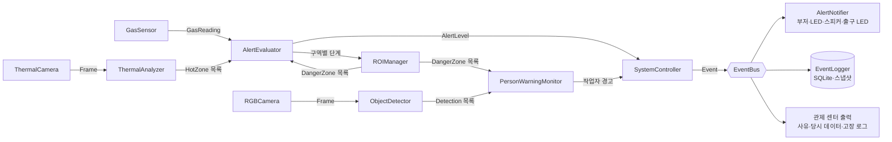

# 03. 인터페이스 정의서

> **이 문서의 역할**
> 클래스(센서·분석·판단·출력·기록)끼리 **주고받는 데이터의 모양**, **DB에 저장하는 모양**, **설정 파일·핀 할당**을 정한 약속입니다.
> 이 약속만 지키면 각 담당자가 서로를 기다리지 않고 동시에 개발할 수 있습니다.
>
> - 문서 버전: v0.6
> - 담당: 통합·문서
> - 코드 구현 위치
>   - 데이터 형식: [`core/models.py`](../core/models.py) — 4번에 해당
>   - 이벤트 전달: [`core/event_bus.py`](../core/event_bus.py) — 3번에 해당
>   - DB·스냅샷 기록: [`logging_/event_logger.py`](../logging_/event_logger.py) — 5번에 해당
>   - 설정값: [`config.yaml`](../config.yaml) — 6번에 해당
> - **규칙: 이 문서를 바꾸면 해당 코드 파일도 같은 커밋에서 같이 바꾼다.** (반대도 마찬가지)
> - **지금 코드와 이 문서가 다른 곳은 8번 '코드 반영 필요 목록'에 있습니다. 기준은 이 문서입니다.**

---

## 1. 공통 규칙

대부분의 연동 오류는 형식이 아니라 **단위·좌표·시간을 다르게 이해해서** 생깁니다.

| 항목 | 규칙 | 이유 |
|---|---|---|
| 시간 | `timestamp` = `time.time()` 유닉스 시간(초). 화면·리포트에는 한국시간(KST)으로 바꿔 표시 | 계산은 숫자로, 사람이 볼 때는 KST로 |
| 온도 | ℃ / 온도 변화는 ℃/초 | |
| 위치 | **픽셀 좌표** `Rect(x, y, w, h)`, 왼쪽 위가 (0, 0). 열화상은 32×24칸, 일반 카메라는 `config.yaml`의 `rgb.width × rgb.height` | 아래 2번 |
| 확률·신뢰도 | 0.0 ~ 1.0 | 0~100(%)과 섞이지 않게 |
| 값이 없을 때 | `None`. **0으로 채우지 않음** | 0℃·0초는 실제 값일 수 있어서 "측정 못 함"과 구분해야 함 |
| 단계·종류 | 문자열 대신 **Enum** (`AlertLevel`, `Reason`, `DetectionClass`) | 오타를 실행 전에 잡을 수 있음 |
| 데이터 묶음 | `core/models.py`의 dataclass만 사용, dict 금지 | 필드 이름이 바뀌면 바로 오류가 나서 찾기 쉬움 |

## 2. 좌표계

두 카메라는 해상도와 시야가 다릅니다. **위험 구역(열화상 좌표)과 작업자(일반 카메라 좌표)를 비교할 때는 열화상 좌표를 일반 카메라 좌표로 바꾼 뒤** 비교합니다 (보정 방법은 [06-system-design](06-system-design.md) 3번).

```
 일반 카메라 화면 (예: 640×480)
 (0,0) ─────────────────────────── x ──▶
   │  [출구 A 영역]
   │
   │        셀 1      셀 2      셀 3
   y
   │                         [출구 B 영역]
   ▼
```

- 출구 A·B 영역은 `config.yaml`에 일반 카메라 좌표 `[x, y, w, h]`로 적습니다 (6번, 키는 코드 작성 시 확정).
- **위험 구역 확대:** 작업자·출구와 비교할 때는 위험 구역을 **중심은 그대로 두고 가로·세로를 배율만큼 늘린** 사각형을 씁니다. 주의 구역은 1.2배, 경보 구역은 1.5배 ([02-state-machine](02-state-machine.md) 4번).
- 작업자 위치는 YOLO 감지 박스(`Detection.bbox`) 전체를 씁니다.

## 3. 데이터 흐름



- `SystemController`는 단계·사유가 바뀌었을 때, 작업자 접근 안내가 생겼을 때, 안내 출구나 고장 상태가 바뀌었을 때만 `Event`를 발행합니다. 같은 내용을 매 루프 보내지 않습니다.
- **센서 고장은 예외 처리합니다** ([ADR-0005](ADR/0005-고장은-예외-처리와-관제-로그.md)). 센서 `read()`가 오류를 내거나 `FAULT_SEC` 동안 새 데이터가 없으면, 루프를 멈추지 않고 그 센서 값을 `None`으로 두고 `faults`에 센서 이름을 넣어 판단을 계속합니다. 고장은 `AlertLevel`이 아닙니다.
- `EventListener.onEvent()`는 **바로 끝나야 합니다.** 스피커 재생처럼 오래 걸리는 일은 따로 실행되게 만듭니다 (루프가 멈추면 감시가 멈춤).

## 4. 데이터 형식 (`core/models.py`)

"지금 코드" 열이 비어 있으면 코드와 문서가 같은 것입니다.

### 4-1. `AlertLevel` (IntEnum) — 경보 단계

| 값 | 숫자 | 뜻 | 지금 코드 |
|---|---|---|---|
| `NORMAL` | 0 | 정상 | 같음 |
| `CAUTION` | 1 | 주의 | `L1_HIGH`, `L2_RAPID_RISE` → **`CAUTION`으로 합침** |
| `ALARM` | 2 | 경보 (래칭) | `L3_CRITICAL` → **`ALARM`으로 이름 변경** |
| `EVACUATE` | 3 | 대피 (래칭) — 경보 + 불·연기 감지 | `L4_FIRE` → **`EVACUATE`로 이름 변경** (뜻도 "불·연기면 바로" → "경보일 때 불·연기"로 바뀜) |

숫자가 클수록 위험합니다. 그래서 `max()`로 여러 구역 중 가장 높은 단계를 고를 수 있습니다. 왜 그 단계인지는 아래 `Reason`으로 따로 남깁니다.

### 4-2. `Reason` (Enum) — 단계가 된 이유 · **새로 추가**

| 값 | 단계 | 뜻 | REQ |
|---|---|---|---|
| `HOT_SUSTAINED` | 주의 | 60℃ 이상 5초 지속 | REQ-001 |
| `HOT_RISING` | 주의 | 5초 안에 30℃ 이상 상승 | REQ-002 |
| `GAS_DETECTED` | 주의 | 가스 기준의 1.5배 이상 | REQ-004 |
| `HOT_EXTREME` | 경보 | 100℃ 이상 10초 유지 | REQ-003 |
| `HOT_CRITICAL` | 경보 | 130℃ 이상 | REQ-022 |
| `GAS_DANGER` | 경보 | 가스 기준의 2배 이상 | REQ-023 |
| `CAUTION_PROLONGED` | 경보 | 주의 원인 1분 지속 | REQ-024 |
| `FIRE_SMOKE` | 대피 | 경보 단계에서 불·연기 감지 | REQ-026 |
| `SENSOR_FAULT` | (단계 아님 — 고장 로그용) | 센서 데이터 없음·읽기 오류 | REQ-010 |

### 4-3. `DetectionClass` (Enum) — YOLO가 찾는 물체

| 값 | 뜻 | 비고 |
|---|---|---|
| `PERSON_MODEL` | 사람 피규어 (작업자) | 필수 |
| `FIRE`, `SMOKE` | 불·연기 | 필수 — 대피 조건 (REQ-026) |

### 4-4. `Rect` — 사각형 영역

| 필드 | 타입 | 단위 | 뜻 |
|---|---|---|---|
| `x`, `y` | int | 픽셀 | 왼쪽 위 꼭짓점 |
| `w`, `h` | int | 픽셀 | 가로·세로 |

| 메서드 | 하는 일 | 지금 코드 |
|---|---|---|
| `overlaps(other) -> bool` | 두 사각형이 겹치는지 | 주석 예시만 있음 → **실제 메서드로** |
| `scaled(factor) -> Rect` | 중심을 유지하고 가로·세로를 `factor`배로 | **새로 추가** (REQ-005) |

### 4-5. `Frame` — 카메라가 읽은 한 장면

| 필드 | 타입 | 단위 | 뜻 |
|---|---|---|---|
| `data` | np.ndarray | ℃ / 픽셀 값 | 열화상: 온도 행렬(24×32) / 일반: 영상(H×W×3) |
| `timestamp` | float | 초 | 찍힌 시각 |
| `source` | str | — | `"thermal"` / `"rgb"` |

### 4-6. `GasReading` — 가스 센서 값 · **새로 추가**

| 필드 | 타입 | 단위 | 뜻 |
|---|---|---|---|
| `raw` | float | V 또는 ADC 값 | 센서에서 읽은 값 (단위는 센서·ADC 확정 후 표기) |
| `ratio` | float \| None | 배 | 깨끗한 공기 기준값 대비 비율 (1.0 = 평소). 기준값을 아직 못 잡았으면 `None` |
| `warmed_up` | bool | — | 예열 완료 여부. **`False`면 판단에 쓰지 않음** (REQ-017) |
| `ok` | bool | — | 센서 정상 여부 |
| `timestamp` | float | 초 | 읽은 시각 |

### 4-7. `HotZone` — 판단 전 후보 구역

| 필드 | 타입 | 단위 | 뜻 | 지금 코드 |
|---|---|---|---|---|
| `bbox` | Rect | 열화상 픽셀 | 구역 범위 | 같음 |
| `max_temp` | float | ℃ | 구역 안 최고 온도 | 같음 |
| `slope` | float | ℃/초 | 구역 안 최대 온도 변화율 (프레임 간) | 같음 |
| `rise` | float \| None | ℃ | 최근 `RISE_WINDOW_SEC`(5초) 동안 오른 온도. 5초치 기록이 아직 없으면 `None` | **새로 추가** (REQ-002) |

> `slope`는 프레임 두 장 사이 변화라 노이즈에 약합니다. 급상승 판단(REQ-002)은 `rise`로 합니다.

### 4-8. `Detection` — YOLO 감지 결과 하나

| 필드 | 타입 | 단위 | 뜻 |
|---|---|---|---|
| `cls` | DetectionClass | — | 종류 |
| `conf` | float | 0~1 | 신뢰도 |
| `bbox` | Rect | 일반 카메라 픽셀 | 감지 박스 |

### 4-9. `DangerZone` — 위험 구역 (판단 후, 주의 이상만)

| 필드 | 타입 | 단위 | 뜻 | 지금 코드 |
|---|---|---|---|---|
| `id` | int | — | 구역 번호 (같은 구역이면 프레임이 바뀌어도 유지) | 같음 |
| `bbox` | Rect | 열화상 픽셀 | 구역 범위 | 같음 |
| `level` | AlertLevel | — | 이 구역의 온도·가스 단계 (`CAUTION` 또는 `ALARM`). 대피는 화면 전체의 불·연기로 정해지므로 전체 단계(`Event.level`)에만 나옴 | 같음 (값 이름만 변경) |
| `reasons` | list[Reason] | — | 이 구역이 그 단계인 이유 | **새로 추가** |
| `max_temp` | float | ℃ | 구역 안 최고 온도 | 같음 |
| `created_at` | float | 초 | 구역이 처음 생긴 시각 | 같음 |
| `caution_since` | float \| None | 초 | 주의 원인이 시작된 시각 (1분 지속 판단용, REQ-024) | **새로 추가** |
| `normal_since` | float \| None | 초 | 기준 아래로 내려간 시각 (해제 판단용) | 같음 |

> 온도 "지속 시간"(5초·10초)을 재려면 구역마다 그 온도가 시작된 시각이 필요합니다. 필드로 둘지 `AlertEvaluator` 안에 둘지는 구현 담당이 정하고 이 표에 반영합니다.

### 4-10. `Event` — EventBus로 보내는 알림

| 필드 | 타입 | 뜻 | 지금 코드 |
|---|---|---|---|
| `level` | AlertLevel | 전체 경보 단계 | 같음 |
| `reasons` | list[Reason] | 전체 단계의 이유 (여러 개 가능) | **새로 추가** |
| `zones` | list[DangerZone] | 현재 위험 구역 | 같음 |
| `person_warning` | AlertLevel \| None | 접근 안내를 할 때 그 단계(`CAUTION`·`ALARM`). 없으면 `None` (스피커 문구 선택용) | `bool` → **변경** |
| `exit_route` | str \| None | 안내할 출구 `"A"`/`"B"`. 경보·대피가 아니거나 대피로가 없으면 `None` | **새로 추가** (REQ-009) |
| `blocked_exits` | list[str] | 막힌 출구 | **새로 추가** |
| `latched` | bool | 리셋 대기 중인지 | **새로 추가** (REQ-008) |
| `faults` | list[str] | 고장 난 센서 이름 (`"thermal"`, `"rgb"`, `"gas"`) | **새로 추가** (REQ-010) |
| `gas_ratio` | float \| None | 그 순간 가스 비율 | **새로 추가** |
| `timestamp` | float | 발행 시각 | 같음 |
| `snapshot` | np.ndarray \| None | 그 순간 일반 카메라 영상 | 같음 |

## 5. 저장 형식

| 무엇을 | 형식 | 위치 | 이유 |
|---|---|---|---|
| 경보 이벤트·평상시 온도 | **SQLite** DB 파일 하나 | `config.yaml`의 `logging.db_path` (지금 `logs/fire_guard.db`) | 사고 하나를 조회 한 번으로 볼 수 있음 ([ADR-0003](ADR/0003-로그는-SQLite와-스냅샷.md)) |
| 경보 순간 사진 | JPG | `logging.snapshot_dir` (지금 `logs/snapshots/`), 파일명 `{timestamp}_L{단계 숫자}.jpg` | 결과보고서·시연 근거 |
| 사고 리포트 | CSV (`utf-8-sig`) | `EventLogger.exportIncidentReport()`가 만든 파일 | 엑셀로 바로 열기. `utf-8-sig`라야 윈도우 엑셀에서 한글이 안 깨짐 |

### 5-1. 관제 센터 로그 (REQ-010, 027)

`Event`를 받아 관제 센터로 보내는 한 건의 내용입니다. 같은 내용을 DB `events`에도 남깁니다.

| 종류 | 언제 보내나 | 담는 내용 |
|---|---|---|
| `LEVEL` | 주의·경보·대피가 되거나 사유가 바뀔 때, 정상으로 돌아왔을 때 | 시각(KST), 단계, 사유 목록, **당시 데이터** (아래) |
| `PERSON` | 작업자 접근 안내 방송을 할 때 | 시각, 단계, 작업자 위치, 겹친 위험 구역 번호 |
| `FAULT` | 센서·카메라 데이터가 안 오거나 읽기 오류 | 시각, 센서 이름(`thermal`/`rgb`/`gas`), 오류 내용, 그 순간 단계 |
| `RECOVERED` | 고장 났던 센서가 다시 데이터를 줄 때 | 시각, 센서 이름, 고장이 이어진 시간 |

**당시 데이터:** 위험 구역별 번호·단계·최고 온도, 가스 비율(예열 여부 포함), 작업자 수·위치, 안내 출구·막힌 출구, 고장 중인 센서, 스냅샷 파일 경로.

- 관제 센터를 어디에 두고 어떤 형식으로 보낼지는 K-11에서 정합니다. 관제 센터가 **라즈베리파이 밖의 PC**라면 네트워크 연결이 생기므로 REQ-021(인터넷 없이 동작)·범위 밖(외부 서버·원격 알림) 항목과 맞는지 함께 확인합니다.
- 관제 센터 전송이 실패해도 판단·경보 루프는 멈추지 않아야 합니다 (DB 기록은 그대로).

### DB 테이블 (초안 — `event_logger.py`의 `_createTables()` 작성 시 확정)

`temperatures` — 평상시 온도 (`logging.temp_interval_sec`마다 1행)

| 열 | 타입 | 뜻 |
|---|---|---|
| `id` | INTEGER PK | 자동 번호 |
| `timestamp` | REAL | 시각 (초) |
| `max_temp` | REAL | 화면 전체 최고 온도 |
| `mean_temp` | REAL | 화면 전체 평균 온도 |

`incidents` — 사고 하나 = 정상에서 벗어난 순간부터 다시 정상이 될 때까지

| 열 | 타입 | 뜻 |
|---|---|---|
| `id` | INTEGER PK | 사고 번호 |
| `started_at` | REAL | 시작 시각 |
| `ended_at` | REAL \| NULL | 끝난 시각 (진행 중이면 NULL) |
| `max_level` | INTEGER | 그 사고에서 가장 높았던 단계 |

`events` — `Event` 하나 = 1행

| 열 | 타입 | 뜻 |
|---|---|---|
| `id` | INTEGER PK | 자동 번호 |
| `incident_id` | INTEGER | 어느 사고의 이벤트인지 |
| `timestamp` | REAL | 시각 |
| `level` | INTEGER | `AlertLevel` 숫자 |
| `reasons` | TEXT | 사유 이름을 `\|`로 이은 문자열. 예: `HOT_RISING\|GAS_DETECTED` |
| `person_warning` | INTEGER \| NULL | 작업자 경고 단계 |
| `exit_route` | TEXT \| NULL | 안내 출구 |
| `faults` | TEXT | 고장 센서를 `\|`로 이은 문자열 |
| `max_temp` | REAL \| NULL | 위험 구역 중 최고 온도 |
| `gas_ratio` | REAL \| NULL | 가스 비율 |
| `snapshot_path` | TEXT \| NULL | 스냅샷 파일 경로 |

- **이벤트를 쓸 때마다 `commit`** 합니다. 그래야 전원이 갑자기 끊겨도 그 직전까지 남습니다 (REQ-012, FMEA F-20).
- 시각은 숫자(초)로 저장하고, 리포트로 내보낼 때 KST 문자열 열을 추가합니다.

## 6. 설정 파일 (`config.yaml`)

| 구역 | 쓰는 곳 | 내용 |
|---|---|---|
| `loop_interval_sec` | `SystemController.loop` | 반복 간격 |
| `thermal` | `ThermalCamera`, `ThermalAnalyzer`, `ThresholdPolicy`, `ROIManager` | 열화상 주기, 후보·주의·경보 온도, 유지 시간 |
| `gas` (**새로 추가**) | `GasSensor`, 가스 판단 규칙 | 핀·채널, 예열 시간, 주의·경보 배수 |
| `decision` (**새로 추가**) | `AlertEvaluator`, `SystemController` | 주의 지속 → 경보 시간, 주의 해제 시간, 고장 판단 시간, 리셋 버튼 핀 |
| `rgb` | `RGBCamera` | 해상도, fps, `picamera2`/`opencv` |
| `yolo` | `ObjectDetector` | 모델 경로, 신뢰도, 입력 크기, 불·연기 신뢰도(`fire_min_conf`) |
| `person_warning` | `PersonWarningMonitor` | 연속 프레임 수, 반복 간격, 배율 1.2·1.5 |
| `notifier` | `AlertNotifier` | 부저·LED 핀, 단계별 부저 주기, 출구 LED 핀·영역, 스피커 설정 |
| `calibration` (**새로 추가, 위치 확정 필요**) | 좌표 변환 | 열화상 → 일반 카메라 변환 행렬 |
| `logging` | `EventLogger` | DB 경로, 스냅샷 폴더, 온도 기록 간격 |
| `response` | (범위 밖) | 차단문·진화장치 — 최종 기획안에 없어 사용하지 않음 |

기준값의 기호·값·제안 키는 [02-state-machine](02-state-machine.md) 6번에 있습니다.

## 7. 핀·하드웨어 자원 할당표

> **HW 담당이 채울 칸입니다.** 같은 핀이나 같은 자원(PWM, I2C 주소 등)을 두 기능이 쓰지 않는지 이 표에서 확인합니다. **`config.yaml`의 핀 번호와 항상 같아야 합니다.**

| 기능 | 장치 | Pi 핀 (BCM) | 사용 자원 | config.yaml | 확인 |
|---|---|---|---|---|---|
| 열화상 | MLX90640 | GPIO2 (SDA), GPIO3 (SCL) | I2C (주소 데이터시트 확인) | — | ☐ |
| 가스 센서 | (모델명) + ADC (아날로그 출력이면) | (ADC가 I2C면 GPIO2·3 공유) | I2C 주소가 열화상과 겹치지 않는지 | `gas` | ☐ |
| 패시브 부저 | | GPIO18 | PWM | `notifier.buzzer_pin` | ☐ |
| 상태 RGB LED | | 빨강 GPIO5 · 초록 GPIO6 · 파랑 GPIO13 | GPIO 출력 (노랑 = 빨강+초록. 파랑은 고장 표시용이었으나 ADR-0005로 사용 안 함) | `notifier.led_pins` | ☐ |
| 출구 A LED | | | GPIO 출력 | (추가 필요) | ☐ |
| 출구 B LED | | | GPIO 출력 | (추가 필요) | ☐ |
| 리셋 버튼 | 푸시 버튼 | | GPIO 입력 (풀업) | (추가 필요) | ☐ |
| 스피커 | | — | 3.5mm 오디오 / USB (GPIO 아님) | (추가 필요) | ☐ |
| (범위 밖) 차단문·진화장치 | — | GPIO17·27·22·23 (설정에만 있음) | — | `response` | — |

## 8. 코드 반영 필요 목록

코드 뼈대(11/25)와 이 문서가 다른 곳입니다. **고친 항목은 이 표에서 지웁니다.** 각 항목은 이슈 하나로 만들 수 있게 나눴습니다.

| # | 파일 | 할 일 | 관련 |
|---|---|---|---|
| K-02 | `core/controller.py` | `actuators.response` import와 `ResponseController` 줄 제거 (범위 밖, 파일 없음) | 01 6번 |
| K-03 | `core/models.py` | `AlertLevel`을 4단계로(`L4_FIRE`→`EVACUATE`), `Reason` 추가, `GasReading` 추가, `Rect.overlaps`·`scaled`, `HotZone.rise`, `DangerZone.reasons`·`caution_since`, `Event` 필드 (4번) | REQ 전체 |
| K-04 | `sensors/gas_sensor.py` | `GasSensor` 작성 (예열·기준값·비율·고장 감지) | REQ-004, 017, 023 |
| K-05 | `decision/policies.py` | 4단계 기준으로 규칙 정리: 온도 지속·급상승(`rise`)·초고온·가스 규칙, `FireDetectionPolicy`는 경보일 때만 대피로 올리게 | REQ-001~004, 022, 023, 026 |
| K-06 | `decision/alert_evaluator.py`, `core/controller.py` | 주의 1분 지속 → 경보, 경보 → 대피, 경보·대피 래칭·리셋 버튼, 주의 20초 해제, 출구 선택 | REQ-008, 009, 013, 024 |
| K-07 | `decision/person_monitor.py` | 위험 구역을 일반 카메라 좌표로 변환 → 단계별 배율(주의 1.2·경보 1.5)로 확대 → 겹침 판단 | REQ-005 |
| K-08 | `actuators/notifier.py` | `COLORS` 표 완성(4단계), 경보 빠른 깜빡임, 출구 LED, 스피커 출력(오래 걸리지 않게) | REQ-020, 009, 025, 005 |
| K-09 | `config.yaml` | 단계 이름(`L1_HIGH` 등)을 `NORMAL`/`CAUTION`/`ALARM`/`EVACUATE`로, 02 6번 제안 키 추가, `gas`·`decision`·출구·리셋 버튼·스피커 설정 추가 | 02 6번 |
| K-10 | `logging_/event_logger.py` | 5번 테이블 생성, 이벤트마다 commit, KST 표시 리포트 | REQ-012 |
| K-11 | (미정) | 관제 센터 위치·방식 결정(라즈베리파이 화면 / 같은 네트워크의 PC 등) 후, `EventListener`로 5-1번 로그 출력 클래스 작성 | REQ-010, 027 |
| K-13 | `sensors/*.py`, `core/controller.py` | 센서별 `read()` 예외 처리, `FAULT_SEC` 동안 새 데이터 없음 감지, `Event.faults` 채우기, 복구 감지 | REQ-010 |
| K-12 | `vision/object_detector.py` | `fire_min_conf`를 받기만 하고 저장하지 않음 → 불·연기 감지에 쓰도록 | REQ-026 |

## 9. 변경 이력

| 날짜 (KST) | 버전 | 바뀐 내용 | 작성 |
|---|---|---|---|
| 2026-11-24 | v0.1 | 초안 작성 | 통합·문서 |
| 2026-11-24 | v0.2 | 로그 저장 JSON → CSV 변경, `seq` 필드 추가, 불·연기 영상 인식 삭제 — 위험 판단을 열화상 동적 ROI로 통일 | 통합·문서 |
| 2026-11-24 | v0.3 | 코드 파일 분리: 메시지 정의는 `messages.py`, CSV 저장·불러오기는 `csv_logger.py` (동작 변경 없음) | 통합·문서 |
| 2026-11-25 | v0.4 | 팀 코드 뼈대에 맞춰 전면 개정: 데이터 형식을 `core/models.py` 기준으로(메시지 클래스 → `Frame`·`HotZone`·`Detection`·`DangerZone`·`Event`), 좌표를 바닥 cm → 카메라 픽셀 + 좌표 변환으로, 기록을 CSV → SQLite·스냅샷으로(ADR-0003), 경보 3단계·`Reason` 추가(ADR-0002), `config.yaml` 구조와 핀 할당표 갱신, 코드 반영 필요 목록(K-01~12) 추가. `messages.py`·`csv_logger.py`는 더 이상 쓰지 않음 | 통합·문서 |
| 2026-11-25 | v0.5 | 대피 단계 반영(ADR-0004): `AlertLevel.EVACUATE` 추가, `FIRE_SMOKE`를 대피 사유로, 불·연기 클래스를 필수로, 코드 반영 목록 K-03·05~09·12 수정 | 통합·문서 |
| 2026-11-25 | v0.6 | ADR-0005 반영: 고장은 단계가 아닌 예외 처리로, 관제 센터 로그 형식(5-1) 추가, 흐름도에 관제 센터 출력 추가, K-01 완료로 삭제(`actuators` 이름 변경), K-08·11 수정, K-13(센서 예외 처리) 추가 | 통합·문서 |
