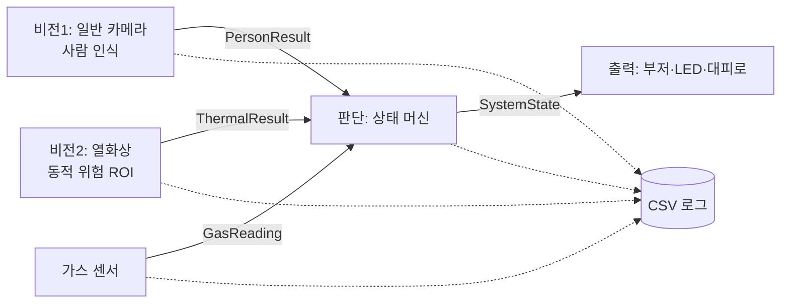

# 03. 인터페이스 정의서

> **이 문서의 역할**
> 모듈(비전1·비전2·가스·판단·출력)끼리 **주고받는 데이터의 모양**과 **CSV로 저장하는 모양**을 정한 약속입니다.
> 이 약속만 지키면 각 담당자가 서로를 기다리지 않고 동시에 개발할 수 있습니다.
>
> - 문서 버전: v0.3
> - 담당: 통합·문서
> - 코드 구현 위치
>   - 메시지 정의: [`src/messages.py`](../src/messages.py) — 4번 '메시지 정의' 표에 해당
>   - CSV 저장·불러오기: [`src/csv_logger.py`](../src/csv_logger.py) — 4번 'CSV 저장'과 5번 '저장 형식'에 해당
> - **규칙: 이 문서를 바꾸면 해당 코드 파일도 같은 커밋에서 같이 바꾼다.** (반대도 마찬가지)

---

## 1. 공통 규칙

모든 메시지가 지켜야 하는 규칙입니다. 대부분의 연동 오류는 형식이 아니라 **단위·좌표·시간을 다르게 이해해서** 생깁니다.

| 항목 | 규칙 | 이유 |
|---|---|---|
| 일련번호 | 모든 메시지에 `seq` (1, 2, 3 … 자동 증가) | CSV 파일 여러 개에 나눠 저장한 행을 다시 묶는 열쇠 |
| 시간 | `t` = 유닉스 시간(초, 소수점 3자리). CSV에는 사람이 읽는 `time_kst`(한국시간)도 같이 저장 | 계산은 `t`로, 사람이 볼 때는 `time_kst`로 |
| 거리·위치 | **바닥 지도 좌표, 단위 cm** (아래 2번 그림) | 카메라 픽셀은 카메라마다 다르고 원근 때문에 실제 거리와 다름 |
| 온도 | ℃ | |
| 확률·신뢰도 | 0.0 ~ 1.0 | 0~100(%)과 섞이지 않게 |
| 값이 없을 때 | 코드에서는 `None`, CSV에서는 **빈칸**. **0으로 채우지 않음** | 0℃·0cm는 실제 값일 수 있어서 "측정 못 함"과 구분해야 함 |
| 참/거짓 | 코드에서는 `True/False`, CSV에서는 `1/0` | 엑셀에서 합계·평균을 바로 낼 수 있음 |
| 메시지 버전 | 모든 메시지에 `v` (현재 `1`) | 형식이 바뀌었을 때 옛날 로그와 구분하기 위해 |

## 2. 좌표계 (바닥 지도)

디오라마를 **위에서 내려다본 지도**를 기준으로 합니다. 두 카메라의 픽셀 좌표는 보정(호모그래피)을 거쳐 이 좌표로 바꿔서 내보냅니다.

```
 (0,0) ────────────── x (cm) ──────────────▶ (60,0)
   │   [출구 A]                                │
   │                                          │
   │        셀 1      셀 2      셀 3           │
   y                                          │
 (cm)                                         │
   │                               [출구 B]    │
   ▼ (0,40) ──────────────────────────────── (60,40)
```

- 원점: 디오라마 바닥 **왼쪽 위 모서리**
- 크기: 가로 60cm × 세로 40cm (**예시 값 — HW 담당이 실제 치수로 수정**)
- 사람 위치 = 감지 박스의 **아래쪽 가운데**(발 위치)를 바닥 좌표로 바꾼 값

## 3. 데이터 흐름



> 위험 판단은 **열화상 기반 동적 ROI**로 통일합니다. 일반 카메라는 사람 인식만 담당합니다. (불·연기 영상 인식은 하지 않기로 결정)

## 4. 메시지 정의

각 메시지마다 **① 필드 표 ② 저장되는 CSV 모양**을 적습니다.

### 4-1. `PersonResult` — 비전1(일반 카메라) → 판단

| 필드 | 타입 | 단위 | 범위 | 뜻 |
|---|---|---|---|---|
| `persons` | list[Person] | — | 0개 이상 | 감지된 사람 목록 (없으면 빈 목록) |
| `persons[].x` | float | cm | 0~60 | 발 위치 x |
| `persons[].y` | float | cm | 0~40 | 발 위치 y |
| `persons[].conf` | float | — | 0~1 | 사람일 확률 |
| `persons[].lying` | bool | — | — | 누운 자세 여부 (쓰러짐 판단용) |
| `ok` | bool | — | — | 카메라 정상 여부 (프레임을 못 읽으면 `False`) |
| `t`, `seq`, `v` | | | | 공통 규칙 참고 |

**CSV 저장:** 목록이 들어 있어서 파일 2개로 나눠 저장합니다.

`person_frames.csv` — 메시지 1개 = 1행
```
seq,t,time_kst,v,n_persons,ok
1,1795516422.691,2026-11-24 19:33:42.691,1,2,1
```
`persons.csv` — 사람 1명 = 1행 (`seq`가 같으면 같은 순간에 찍힌 사람들)
```
seq,t,time_kst,idx,x,y,conf,lying
1,1795516422.691,2026-11-24 19:33:42.691,0,22.4,30.1,0.91,0
1,1795516422.691,2026-11-24 19:33:42.691,1,41.0,12.5,0.78,1
```

### 4-2. `ThermalResult` — 비전2(열화상) → 판단

| 필드 | 타입 | 단위 | 범위 | 뜻 |
|---|---|---|---|---|
| `hot_rois` | list[HotRoi] | — | 0개 이상 | 위험 구역(동적 ROI) 목록 |
| `hot_rois[].id` | int | — | 1 이상 | 구역 번호 (같은 구역이면 프레임이 바뀌어도 같은 번호 유지) |
| `hot_rois[].x`, `.y` | float | cm | 바닥 범위 | 구역 중심 |
| `hot_rois[].r` | float | cm | 0 초과 | 위험 반경 (온도가 높을수록 커짐) |
| `hot_rois[].tmax` | float | ℃ | -40~300 | 구역 안 최고 온도 |
| `hot_rois[].rate` | float | ℃/초 | — | 최근 N초 평균 상승 속도 (음수면 식는 중) |
| `hot_rois[].hot_sec` | float | 초 | 0 이상 | 기준 온도 이상이 계속된 시간 |
| `ambient` | float \| None | ℃ | — | 화면 전체 평소 온도(기준선) |
| `ok` | bool | — | — | 열화상 정상 여부 |
| `t`, `seq`, `v` | | | | 공통 규칙 참고 |

**CSV 저장:** 파일 2개.

`thermal_frames.csv` — 메시지 1개 = 1행. 위험 구역이 없는 프레임도 기록됩니다(`n_rois`=0).
```
seq,t,time_kst,v,ambient,n_rois,ok
2,1795516422.693,2026-11-24 19:33:42.692,1,23.1,1,1
3,1795516422.693,2026-11-24 19:33:42.692,1,23.0,0,1
```
`hot_rois.csv` — 위험 구역 1개 = 1행
```
seq,t,time_kst,id,x,y,r,tmax,rate,hot_sec
2,1795516422.693,2026-11-24 19:33:42.692,3,30.0,18.5,6.2,64.2,0.8,12.0
```

### 4-3. `GasReading` — 가스 센서 → 판단

| 필드 | 타입 | 단위 | 범위 | 뜻 |
|---|---|---|---|---|
| `raw_v` | float | V | 0~3.3 | ADC로 읽은 전압 |
| `ratio` | float | 배 | 0 이상 | 시작 시 기준 전압 대비 비율 (1.0 = 평소) |
| `warmed_up` | bool | — | — | 예열 완료 여부. **`False`면 판단에 쓰지 않음** |
| `ok` | bool | — | — | 센서 정상 여부 |
| `t`, `seq`, `v` | | | | 공통 규칙 참고 |

**CSV 저장:** 목록이 없어서 `gas.csv` 하나에 메시지 1개 = 1행.
```
seq,t,time_kst,raw_v,ratio,warmed_up,ok,v
4,1795516422.693,2026-11-24 19:33:42.693,0.62,1.55,1,1,1
```

### 4-4. `SystemState` — 판단 → 출력 / 로그

| 필드 | 타입 | 단위 | 범위 | 뜻 |
|---|---|---|---|---|
| `level` | str | — | `NORMAL` `CAUTION` `WARNING` `EVACUATE` `FAULT` | 경보 단계 ([02-state-machine.md](02-state-machine.md) 참고) |
| `reasons` | list[str] | — | 아래 코드표 | 이 단계가 된 이유 (여러 개 가능) |
| `persons_in_zone` | int | 명 | 0 이상 | 감시 구역 안 인원 |
| `route` | list[str] | — | 노드 이름 | 안내할 대피 경로. 예: `N3`→`N2`→`EXIT_A`. 없으면 빈 목록 |
| `blocked_edges` | list[str] | — | 엣지 이름 | 위험해서 막힌 통로. 예: `N3-N4` |
| `latched` | bool | — | — | 수동 리셋 전까지 유지 중인지 |
| `t`, `seq`, `v` | | | | 공통 규칙 참고 |

이유 코드표 (`reasons`에 들어가는 값):

| 코드 | 뜻 |
|---|---|
| `HOT_SUSTAINED` | 고온이 일정 시간 이상 지속 |
| `HOT_RISING` | 온도 급상승 |
| `HOT_EXTREME` | 매우 높은 온도 |
| `GAS` | 가스 증가 |
| `PERSON_IN_ROI` | 위험 구역 안에 사람 있음 |
| `PERSON_DOWN` | 쓰러진 사람 있음 |
| `SENSOR_FAULT` | 센서 고장·응답 없음 |

**CSV 저장:** `states.csv` 하나에 1행. 문자열 목록은 **`|`로 이어 붙여 한 칸**에 넣습니다.
```
seq,t,time_kst,level,reasons,persons_in_zone,route,blocked_edges,latched,v
5,1795516422.693,2026-11-24 19:33:42.693,WARNING,HOT_RISING|PERSON_IN_ROI,1,N3|N2|EXIT_A,N3-N4,0,1
```
> `|`를 쓰는 이유: 쉼표(`,`)는 CSV에서 칸을 나누는 기호라 목록 구분에 쓰면 칸이 밀립니다.

## 5. 저장 형식

| 무엇을 | 형식 | 파일 위치 | 이유 |
|---|---|---|---|
| 메시지 로그 | **CSV** (표 종류별 파일 6개) | `data/logs/YYYYMMDD_HHMMSS/*.csv` | 엑셀로 바로 열어 그래프·필터 가능. 실행 1번 = 폴더 1개 |
| 열화상 원본 프레임 | numpy `.npy` | `data/raw/thermal/` | 768칸 배열은 CSV로 저장하면 크고 느림 |
| 일반 카메라 원본 | 영상 `.mp4` | `data/raw/rgb/` | |
| 보정 결과 (픽셀 → cm 변환 행렬 3×3) | CSV (숫자 3줄 × 3칸) | `config/calibration_rgb.csv`, `config/calibration_thermal.csv` | `numpy.savetxt` / `loadtxt` 한 줄로 저장·불러오기 |

CSV 파일 공통 설정:
- 인코딩 `utf-8-sig` (윈도우 엑셀에서 한글이 깨지지 않음)
- 첫 줄은 열 이름(헤더). 열 순서는 `csv_logger.py`의 `COLUMNS`에 고정
- 한 행을 쓸 때마다 디스크에 바로 기록(flush) → 프로그램이 멈춰도 그 전까지의 기록은 남음

**여러 파일을 다시 합치는 법:** `seq`가 같은 행끼리 묶으면 됩니다. 예) `thermal_frames.csv`의 seq 2번 행 + `hot_rois.csv`의 seq 2번 행들 = 그 순간의 열화상 결과 전체. 코드는 `csv_logger.py`의 `load_thermal()` 참고.

## 6. 핀·하드웨어 자원 할당표

> **HW 담당이 채울 칸입니다.** 같은 핀이나 같은 자원(PWM, SPI 등)을 두 기능이 쓰지 않는지 이 표에서 확인합니다.

| 기능 | 장치 | Pi 핀 (BCM) | 사용 자원 | 확인 |
|---|---|---|---|---|
| 열화상 | (모델명) | GPIO2, GPIO3 | I2C | ☐ |
| 가스 센서 ADC | (모델명) | GPIO2, GPIO3 | I2C (주소: ) | ☐ |
| 패시브 부저 | | | PWM | ☐ |
| LED (대피로) | | | | ☐ |
| 리셋 버튼 | | | GPIO 입력 | ☐ |
| 발열패드 전원 차단 | 릴레이/MOSFET | | GPIO 출력 | ☐ |

## 7. 변경 이력

| 날짜 (KST) | 버전 | 바뀐 내용 | 작성 |
|---|---|---|---|
| 2026-11-24 | v0.1 | 초안 작성 | 통합·문서 |
| 2026-11-24 | v0.2 | 로그 저장 JSON → CSV 변경, `seq` 필드 추가, 불·연기 영상 인식(`fire_conf`, `smoke_conf`, `FIRE_VISION`) 삭제 — 위험 판단을 열화상 동적 ROI로 통일 | 통합·문서 |
| 2026-11-24 | v0.3 | 코드 파일 분리: 메시지 정의는 `messages.py`, CSV 저장·불러오기는 `csv_logger.py` (동작 변경 없음) | 통합·문서 |
