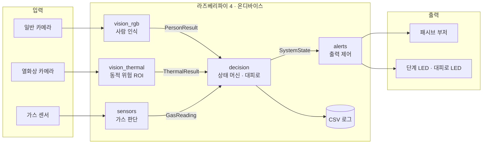

# 06. 시스템 설계

> **이 문서의 역할**
> 시스템이 **어떻게 생겼고(구조), 데이터가 어떻게 흐르고(파이프라인), 왜 이 모델·부품을 골랐는지(선정 근거)**를 정리합니다.
> 평가의 "온디바이스 AI 설계"(20점: 구조·데이터 흐름 8 / 모델·부품 선정 근거 6 / 추론 파이프라인 6)를 증명하는 문서입니다 ([00-project-guide](00-project-guide.md) 10번).
>
> - 문서 버전: v0.1 (초안 — 빈칸은 결정되는 대로 채움)
> - 담당: SW/AI (모델·파이프라인), HW (부품·구성)
> - 관련 문서: [01-requirements](01-requirements.md) · [02-state-machine](02-state-machine.md) · [03-interface](03-interface.md) · [hardware/](hardware/)

---

## 1. 시스템 구조

- 모든 감지·판단·경보는 **라즈베리파이 안에서** 처리합니다. 인터넷 연결이 없어도 동작합니다 (REQ-021).
- 모듈끼리는 [03-interface](03-interface.md)에 정의한 객체로만 주고받습니다. 그래서 각 모듈을 따로 개발·시험할 수 있습니다.
- **MCU (보류):** 사용이 확정되면 무엇을 맡는지(예: LED·부저 구동, 센서 읽기) 이 그림에 추가합니다. 라즈베리파이와의 통신 방식도 03번에 추가합니다.

## 2. 처리 흐름 (추론 파이프라인)

한 번의 판단 주기에서 일어나는 일입니다.

| 순서 | 모듈 | 하는 일 | 결과 |
|---|---|---|---|
| 1 | vision_thermal | 열화상 프레임 읽기 → 고온 영역 찾기 → 위험 반경·상승률 계산 | `ThermalResult` |
| 2 | vision_rgb | 카메라 프레임 읽기 → 사람 인식 추론 → 발 위치를 바닥 좌표(cm)로 변환 | `PersonResult` |
| 3 | sensors | 가스 센서 읽기 → 예열 여부·기준 대비 비율 계산 | `GasReading` |
| 4 | decision | 세 결과를 시각(`t`)으로 맞춰 합침 → 상태 머신 전환 → 대피로 계산 | `SystemState` |
| 5 | alerts | 단계별 부저 주기·LED 색·대피로 LED 출력 | 현장 경보 |
| 6 | csv_logger | 모든 결과를 CSV로 기록 | `data/logs/` |

**처리 속도 설계 (확정 필요):**
- 열화상·가스는 가볍기 때문에 자주 처리합니다.
- 사람 인식은 무거워서 더 낮은 빈도로 처리해도 되는지 측정 후 정합니다.
- 목표는 위험 발생부터 경보까지 **3초 이내**예요 (REQ-011). 단계별 소요 시간은 [07-performance](07-performance.md)에 기록합니다.

## 3. 좌표 맞추기 (보정)

두 카메라는 픽셀 크기와 시야가 달라서, 같은 바닥 좌표(cm)로 바꿔야 비교할 수 있습니다 ([03-interface](03-interface.md) 2번).
- **방법:** 발열패드를 바닥 4곳 이상에 놓고, 두 카메라 화면 좌표와 실제 cm 좌표를 짝지어 변환 행렬(호모그래피)을 구합니다. 발열패드는 일반 카메라에도 보이고 열화상에서도 뜨겁게 보여서 보정 표식으로 쓸 수 있습니다.
- **결과 위치:** `config/calibration_rgb.csv`, `config/calibration_thermal.csv`
- 카메라 위치가 바뀌면 다시 보정합니다.

## 4. 모델 선정 근거 (사람 인식)

| 항목 | 내용 |
|---|---|
| 후보 | (예) 공개 사전학습 객체 인식 모델(사람 클래스 포함), 직접 학습한 피규어 전용 모델 |
| 선정 기준 | ① 피규어 인식 재현율 (REQ-016) ② 라즈베리파이 4에서의 처리 속도 ③ 모델 크기 ④ 학습에 드는 시간 |
| 시험 결과 | ([07-performance](07-performance.md) 2번 표 참고) |
| 결정 | (시험 후 기록) |
| 결정 이유 | (시험 결과 숫자를 근거로 작성) |

**경량화 (Part 1 학습 내용 반영):** 변환 형식과 양자화 여부, 그 전후의 속도·정확도 비교를 [07-performance](07-performance.md) 3번에 기록하고 여기에 결론만 요약합니다.

## 5. 부품 선정 근거

전체 목록은 [hardware/bom.csv](hardware/bom.csv)에 있습니다. 여기에는 **왜 골랐는지**만 적습니다.

| 부품 | 고른 이유 | 대안과 비교 |
|---|---|---|
| 열화상 카메라 | 눈에 안 보이는 셀 발열을 직접 측정 — 핵심 기술(동적 ROI)의 입력 | (모델명·해상도·측정 범위 기입) |
| 일반 카메라 | 사람 위치 인식 | |
| 가스 검출기 | 셀 이상 시 가스가 먼저 나올 수 있어 열 감지를 보완 | |
| 캡톤 히터 ×3 + 스위치 ×3 | 셀 3개를 각각 독립적으로 과열시켜 원하는 상황을 재현 | |
| 방열판 | 열용량이 큰 모듈을 흉내 — 늦게 달아오르고 늦게 식는 장면 재현 | |
| 패시브 부저 | 주파수·주기를 바꿔 경보 단계를 소리로 구분 (REQ-020) | 액티브 부저는 주파수 변경 불가 |
| LED | 단계 색 표시, 대피로 안내 | (방식 결정: 주소 지정 LED 스트립 / 개별 LED) |
| MCU (보류) | | |

## 6. 결정 기록

중요한 설계 결정은 [ADR/](ADR/) 폴더에 하나씩 남깁니다.

| ADR | 결정 |
|---|---|
| [ADR-0001](ADR/0001-대피경보는-온도100도-이상.md) | 대피 경보는 100℃ 이상일 때 |

## 7. 변경 이력

| 날짜 (KST) | 버전 | 바뀐 내용 | 작성 |
|---|---|---|---|
| 2026-11-24 | v0.1 | 초안 작성 | 통합·문서 |
