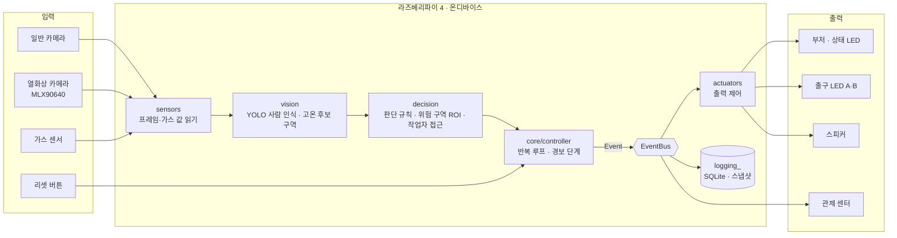

# 06. 시스템 설계

> **이 문서의 역할**
> 시스템이 **어떻게 생겼고(구조), 데이터가 어떻게 흐르고(파이프라인), 왜 이 모델·부품을 골랐는지(선정 근거)**를 정리합니다.
> 평가의 "온디바이스 AI 설계"(20점: 구조·데이터 흐름 8 / 모델·부품 선정 근거 6 / 추론 파이프라인 6)를 증명하는 문서입니다 ([00-project-guide](00-project-guide.md) 10번).
>
> - 문서 버전: v0.4 (초안 — 빈칸은 결정되는 대로 채움)
> - 담당: SW/AI (모델·파이프라인), HW (부품·구성)
> - 관련 문서: [01-requirements](01-requirements.md) · [02-state-machine](02-state-machine.md) · [03-interface](03-interface.md) · [hardware/](hardware/)

---

## 1. 시스템 구조

- 모든 감지·판단·경보는 **라즈베리파이 안에서** 처리합니다. 인터넷 연결이 없어도 동작합니다 (REQ-021).
- 클래스끼리는 [03-interface](03-interface.md)에 정의한 객체(`core/models.py`)로만 주고받습니다. 그래서 각 클래스를 따로 개발·시험할 수 있습니다.
- **EventBus를 쓰는 이유:** 판단 쪽은 "무슨 일이 생겼다(Event)"만 알리고, 부저·LED·기록은 각자 구독해서 처리합니다(옵저버 패턴). 출력 장치를 늘리거나 빼도 판단 코드를 고치지 않아도 되고, 출력 하나가 오류를 내도 나머지는 계속 동작합니다 (`EventBus.publish`의 예외 처리).
- **MCU (보류):** 사용이 확정되면 무엇을 맡는지(예: LED·부저 구동, 센서 읽기) 이 그림에 추가합니다. 라즈베리파이와의 통신 방식도 03번에 추가합니다.

## 2. 처리 흐름 (추론 파이프라인)

`core/controller.py`의 `loop()` 한 번에 일어나는 일입니다. 반복 간격은 `config.yaml`의 `loop_interval_sec`입니다.

| 순서 | 담당 클래스 | 하는 일 | 결과 |
|---|---|---|---|
| 1 | `ThermalCamera`, `RGBCamera`, `GasSensor` | 열화상 온도 행렬(32×24), 일반 카메라 영상, 가스 값 읽기 | `Frame`, `GasReading` |
| 2 | `EventLogger.logTemperature` | 평상시 온도를 정해진 간격으로 기록 | DB `temperatures` |
| 3 | `ThermalAnalyzer.findHotZones` | 후보 온도 이상이거나 빠르게 오르는 픽셀을 묶어 후보 구역으로 | `HotZone` 목록 |
| 4 | `ObjectDetector.detect` | YOLO로 작업자(사람 피규어)와 불·연기 찾기 | `Detection` 목록 |
| 5 | `AlertEvaluator.evaluateZone` | 후보 구역마다 주의·경보 조건 판단 ([02](02-state-machine.md) 2번) | 구역별 단계·사유 |
| 6 | `ROIManager.update` | 주의 이상인 후보만 위험 구역으로 지정·추적, 정상이 유지되면 해제 | `DangerZone` 목록 |
| 7 | `AlertEvaluator.overallLevel` | 위험 구역 + 가스 + 주의 지속 시간 + (경보일 때) 불·연기 + 래칭·리셋으로 전체 단계 결정 | `AlertLevel` |
| 8 | `PersonWarningMonitor.check` | 작업자가 확대한 위험 구역(주의 1.2배·경보 1.5배)과 겹치는지 | 접근 안내 방송 여부 |
| 9 | `EventBus.publish` | 단계·사유·고장 상태가 바뀌었거나 작업자 접근 안내가 있을 때만 `Event` 발행 | `AlertNotifier`·`EventLogger`·관제 센터 출력이 받아 처리 |

**처리 속도 설계 (확정 필요):**
- 열화상은 `refresh_hz`(MLX90640 기준 1·2·4·8Hz 등)로 들어오므로, 루프가 그보다 빨라도 새 프레임은 그 속도로만 생깁니다.
- 사람 인식은 무거워서 더 낮은 빈도로 처리해도 되는지 측정 후 정합니다.
- 목표는 위험 발생부터 경보까지 **3초 이내**예요 (REQ-011). 단계별 소요 시간은 [07-performance](07-performance.md)에 기록합니다.

## 3. 두 카메라 좌표 맞추기 (보정)

위험 구역은 **열화상 좌표**(32×24칸)로, 작업자는 **일반 카메라 좌표**(예: 640×480)로 나옵니다. 두 카메라는 해상도·시야·설치 위치가 달라서, **같은 좌표로 바꿔야 겹치는지 비교할 수 있습니다** (REQ-005).
- **방법(안):** 히터를 바닥 4곳 이상에 놓고, 두 화면에서 같은 히터의 좌표를 짝지어 열화상 → 일반 카메라 변환 행렬(호모그래피)을 구합니다. 히터는 일반 카메라에도 보이고 열화상에서도 뜨겁게 보여서 보정 표식으로 쓸 수 있습니다.
- **결과 저장 위치:** 정해지면 `config.yaml`에 키를 추가하고 [03-interface](03-interface.md) 6번에 적습니다.
- 카메라 위치가 바뀌면 다시 보정합니다 (FMEA F-04).
- 두 카메라를 최대한 가까이, 같은 방향으로 붙여 설치하면 변환 오차가 줄어듭니다.

## 4. 모델 선정 근거 (사람 인식)

| 항목 | 내용 |
|---|---|
| 현재 설정 | `config.yaml`의 `yolo.model_path` = YOLO nano 모델의 NCNN 변환본 (입력 크기 `imgsz` 416) |
| 후보 | (예) 공개 사전학습 모델(사람 클래스 포함), 사람 피규어·불·연기로 추가 학습한 모델 |
| 선정 기준 | ① 피규어 인식 재현율 (REQ-016) ② 불·연기 인식 재현율 (REQ-026) ③ 라즈베리파이 4에서의 처리 속도 ④ 모델 크기 ⑤ 학습에 드는 시간 |
| 시험 결과 | ([07-performance](07-performance.md) 2번 표 참고) |
| 결정 | (시험 후 기록) |
| 결정 이유 | (시험 결과 숫자를 근거로 작성) |

**경량화 (Part 1 학습 내용 반영):** 변환 형식(NCNN 등)과 양자화 여부, 그 전후의 속도·정확도 비교를 [07-performance](07-performance.md) 3번에 기록하고 여기에 결론만 요약합니다.

**불·연기 인식 (대피 조건, REQ-026):** 사람 모델에 불·연기 클래스를 함께 학습할지, 따로 둘지 정하고 데이터 출처와 성능을 여기에 기록합니다. 모델을 두 개 돌리면 라즈베리파이 처리 속도가 떨어질 수 있어 [07](07-performance.md)에서 측정 후 결정합니다.

## 5. 부품 선정 근거

전체 목록은 [hardware/bom.csv](hardware/bom.csv)에 있습니다. 여기에는 **왜 골랐는지**만 적습니다.

| 부품 | 고른 이유 | 대안과 비교 |
|---|---|---|
| 열화상 카메라 MLX90640 | 눈에 안 보이는 셀 발열을 직접 측정 — 핵심 기술(동적 ROI)의 입력. I2C로 라즈베리파이에 바로 연결 | 해상도 32×24 — 작은 히터는 픽셀 평균 때문에 실제보다 낮게 보일 수 있음 (F-23). 측정 범위·시야각은 데이터시트 확인 후 기입 |
| 일반 카메라 | 작업자 위치 인식 (YOLO 입력) | 라즈베리파이 카메라 모듈(picamera2) / USB 카메라(opencv) 둘 다 코드에서 지원 |
| 가스 검출기 | 셀 이상 시 가스가 온도 변화보다 먼저 나올 수 있어 열 감지를 보완 | 아날로그 출력이면 라즈베리파이에 ADC가 필요 (확인 필요) |
| 캡톤 히터 ×3 + 스위치 ×3 | 셀 3개를 각각 독립적으로 과열시켜 원하는 상황을 재현 | |
| 방열판 | 열용량이 큰 모듈을 흉내 — 늦게 달아오르고 늦게 식는 장면 재현 | |
| 패시브 부저 | 주기를 바꿔 경보 단계를 소리로 구분 (REQ-020) | 액티브 부저는 소리 높이 변경 불가 |
| 상태 RGB LED | LED 하나로 초록·노랑·빨강 표시 (고장은 현장 표시 없이 관제 센터 로그, ADR-0005) | |
| 출구 LED (출구 A·B) | 경보 단계에서 안전한 출구 안내 (REQ-009) | 개수·종류는 HW 확정 |
| 스피커 | 대피 안내 방송, 작업자 접근 안내 방송 (REQ-005, 025) — 부저로는 음성 불가 | 연결 방식(3.5mm·USB·앰프) HW 확정 |
| 리셋 버튼 | 경보 래칭 해제 (REQ-008) | |
| MCU (보류) | | |

## 6. 결정 기록

중요한 설계 결정은 [ADR/](ADR/) 폴더에 하나씩 남깁니다.

| ADR | 결정 | 상태 |
|---|---|---|
| [ADR-0001](ADR/0001-대피경보는-온도100도-이상.md) | 대피 경보는 100℃ 이상일 때 | ADR-0002로 대체 |
| [ADR-0002](ADR/0002-경보-3단계와-판단-기준.md) | 주의·경보 조건 (단계 수는 ADR-0004에서 4단계로) | 확정 |
| [ADR-0003](ADR/0003-로그는-SQLite와-스냅샷.md) | 기록은 SQLite DB + 경보 순간 스냅샷 | 확정 |
| [ADR-0004](ADR/0004-대피-단계-추가.md) | 경보 위에 대피 단계 추가 (경보 + 불·연기) | 확정 |
| [ADR-0005](ADR/0005-고장은-예외-처리와-관제-로그.md) | 고장은 단계가 아닌 예외 처리 + 관제 센터 로그 | 확정 |

## 7. 변경 이력

| 날짜 (KST) | 버전 | 바뀐 내용 | 작성 |
|---|---|---|---|
| 2026-11-24 | v0.1 | 초안 작성 | 통합·문서 |
| 2026-11-25 | v0.2 | 코드 뼈대 구조로 다시 그림 (EventBus·폴더 이름), 처리 흐름을 `controller.loop()` 순서로, 보정을 열화상→일반 카메라 좌표 변환으로, 부품에 MLX90640·스피커·출구 LED·리셋 버튼 추가, ADR 표 갱신 | 통합·문서 |
| 2026-11-25 | v0.3 | 대피 단계 반영: 불·연기 인식을 필수로(파이프라인·모델 선정 기준), ADR-0004 추가 | 통합·문서 |
| 2026-11-25 | v0.4 | ADR-0005 반영: 구성도·처리 흐름에 관제 센터 출력 추가, RGB LED 고장 표시 삭제 | 통합·문서 |
